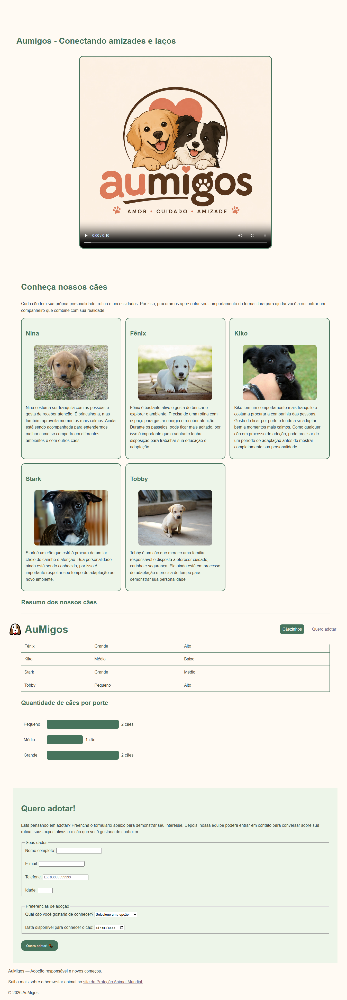

# AuMigos — Adoção Responsável de Cães

## Sobre o projeto

O **AuMigos** é um site desenvolvido como projeto acadêmico de Front-End, com o objetivo de apresentar cães disponíveis para adoção e incentivar a adoção responsável. A página permite conhecer cinco cães, visualizar suas características e preencher um formulário para demonstrar interesse na adoção. Após o preenchimento, a proposta é que a equipe responsável entre em contato com o interessado. O projeto também inclui uma página de análise de dados, desenvolvida para aplicar os conteúdos de lógica de programação, funções, arrays, manipulação do DOM e eventos em JavaScript.

## Funcionalidades

- Apresentação de cinco cães: Nina, Fênix, Kiko, Stark e Tobby.
- Informações sobre o comportamento e as características de cada cão.
- Menu de navegação com submenu e versão responsiva.
- Formulário de interesse na adoção com validação de campos.
- Vídeo com formatos MP4 e WebM, poster e legendas em `.vtt`.
- Tabela comparativa dos cães.
- Gráfico SVG com a quantidade de cães por porte.
- Layout adaptado para computadores e dispositivos móveis.
- Página de análise de dados com busca por nome.
- Seleção de cães e atualização dinâmica dos resultados.
- Demonstração de estruturas de decisão, repetição, funções e métodos de arrays.

**Observação:** o formulário demonstra o fluxo de interesse na adoção. O projeto não possui integração com banco de dados ou serviço de envio de informações.

## Tecnologias utilizadas

- **HTML5:** estrutura semântica, formulários, tabelas, multimídia e SVG.
- **CSS3:** estilização, variáveis, Flexbox, Grid, menus e responsividade.
- **JavaScript:** lógica de programação, funções, arrays, manipulação do DOM e eventos.
- **Git e GitHub:** versionamento e organização do projeto.

## Capturas de tela

### Versão para computador



### Versão para celular


## Estrutura do projeto

```text
aumigos/
├── index.html
├── analise.html
├── README.md
├── css/
│   ├── reset.css
│   ├── style.css
│   └── analise.css
├── js/
│   ├── menu.js
│   ├── formulario.js
│   └── logica.js
└── assets/
    ├── images/
    │   ├── nina.jpg
    │   ├── fenix.jpg
    │   ├── kiko.jpg
    │   ├── stark.jpg
    │   ├── tobby.jpg
    │   ├── print_pc.png
    │   └── print_mobile.png
    └── video/
        ├── cachorro.mp4
        ├── cachorro.webm
        ├── cachorro-poster.jpg
        └── cachorro.vtt
```
## Como executar

**Opção 1 — Execução local**

1. Clone ou baixe o repositório do projeto.
2. Abra a pasta no Visual Studio Code.
3. Abra o arquivo `index.html` no navegador para visualizar o site.
4. Para acessar o analisador de dados, abra `analise.html`.
5. Na página de análise, utilize a busca e os botões disponíveis. O Console do navegador (F12) também apresenta resultados dos testes em JavaScript.

**Opção 2 — Acesso online (GitHub Pages)**

O projeto também está disponível online pelo GitHub Pages, permitindo acessar suas páginas diretamente pelo navegador, sem necessidade de baixar os arquivos ou instalar ferramentas.

- **Site principal — AuMigos:** [Acessar site](https://somiresz.github.io/projeto-integrador-frontend-lindsay/Aumigos%20-%20atividade/)
- **Página de análise de dados:** [Acessar analisador](https://somiresz.github.io/projeto-integrador-frontend-lindsay/Aumigos%20-%20atividade/analise.html)

## Mapa dos requisitos

| Requisito | Implementação |
|---|---|
| Estrutura semântica HTML5 | `index.html` — header, nav, main, section, article e footer |
| Formulário e validações | `index.html` — seção Quero adotar |
| Multimídia com formatos alternativos | `index.html` — seção de vídeo |
| Legendas e poster | `assets/video/` |
| Tabela e gráfico SVG | `index.html` — seção Conheça nossos cães |
| Reset e estilização CSS | `css/reset.css` e `css/style.css` |
| Flexbox, Grid e responsividade | `css/style.css` |
| Menu interativo | `js/menu.js` |
| Comportamento do formulário | `js/formulario.js` |
| Estruturas de decisão e repetição | `js/logica.js` |
| Funções e classificação de dados | `js/logica.js` |
| Métodos map, filter e reduce | `js/logica.js` |
| Manipulação do DOM e eventos | `js/logica.js` |
| Interface do analisador | `analise.html` e `css/analise.css` |

## Autoria

- **Desenvolvimento:** Lindsay Soares Miranda
- **Curso:** Análise e Desenvolvimento de Sistemas
- **RGM:** 48352471

---

## Avaliação 1

DATA - quarta feira, 02 de setembro, 2026  
Avaliação em pares

Em relação à estrutura semântica, o conteúdo está organizado utilizando elementos como `<header>`, `<main>`, `<section>`, `<article>`, `<nav>` e `<footer>`, dando significado adequado às diferentes partes da página.  
Foi utilizado apenas um `<main>`, conforme solicitado, e o conteúdo principal foi dividido em seções distintas, cada uma com seus respectivos headings.  
A hierarquia dos títulos também está organizada de forma adequada, começando pelo `<h1>` e utilizando `<h2>` para as seções principais e `<h3>` para os conteúdos internos, sem pular níveis.

A navegação foi implementada utilizando a tag `<nav>` e links com `<a>`, evitando o uso de elementos genéricos para funções interativas.  
Dessa forma, os elementos utilizados possuem semântica apropriada e contribuem para uma estrutura mais acessível.

O formulário também está coerente com o tema do projeto, pois foi criado para demonstrar interesse na adoção de um dos cães disponíveis.  
Ele possui mais de quatro campos e utiliza tipos semanticamente adequados, como `text`, `email`, `tel`, `number` e `date`.  
Foram utilizados campos obrigatórios com `required` e também foi aplicado `pattern` no campo de telefone, além de `min` e `max` no campo de idade.  
Os campos estão agrupados por meio de `<fieldset>` e `<legend>`, e os `<label>` estão corretamente associados aos respectivos inputs através dos atributos `for` e `id`.

Na parte de multimídia, foi adicionada uma seção de vídeo relacionada diretamente ao tema do projeto, utilizando dois formatos diferentes, MP4 e WebM, através de múltiplas tags `<source>`.  
Dessa forma, existe fallback caso um dos formatos não seja suportado pelo navegador. A ordem dos formatos foi definida e os arquivos foram testados.

Foi utilizado `preload="metadata"` e a escolha foi justificada por meio de um comentário no HTML, explicando que o vídeo é um conteúdo complementar da página e que o carregamento apenas dos metadados evita o carregamento completo antes da reprodução.  
O vídeo também possui um poster configurado.

Além disso, foram adicionadas legendas utilizando `<track>` e um arquivo `.vtt` contendo três blocos de tempo.  
As legendas foram testadas durante a reprodução do vídeo.  
Também foi utilizado o método `canPlayType()` para verificar a compatibilidade dos formatos, sendo que os testes realizados retornaram "probably" tanto para o MP4 quanto para o WebM, atendendo ao requisito da atividade.

A mídia escolhida possui relação direta com o tema do projeto, apresentando cães em um site voltado à adoção responsável, portanto a utilização do vídeo é coerente com a proposta do AuMigos.

Em relação ao versionamento, o projeto foi publicado no GitHub, foi criada uma branch específica para a atividade e utilizado um commit seguindo o padrão Conventional Commits, com a mensagem "feat: adiciona seção de vídeo com fallback de formatos".  
Também foi criado um Pull Request para a branch main, posteriormente mesclado ao projeto.

De forma geral, o projeto apresenta uma estrutura semântica adequada, formulário coerente e corretamente estruturado e uma implementação de mídia que contempla os requisitos da Aula 04. Os principais conceitos apresentados nas Aulas 03 e 04 foram aplicados corretamente ao projeto.

---

## Avaliação 2

*Espaço reservado para a avaliação da segunda dupla*
